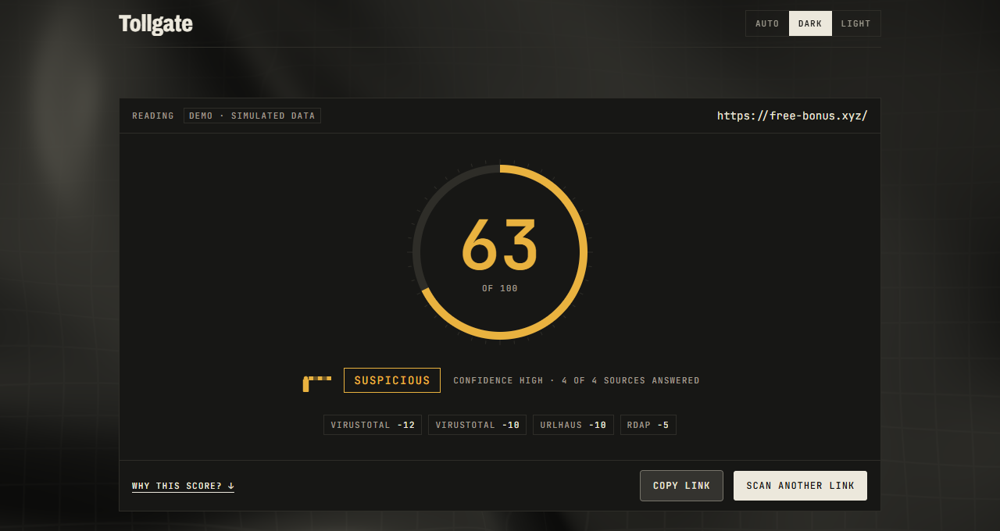
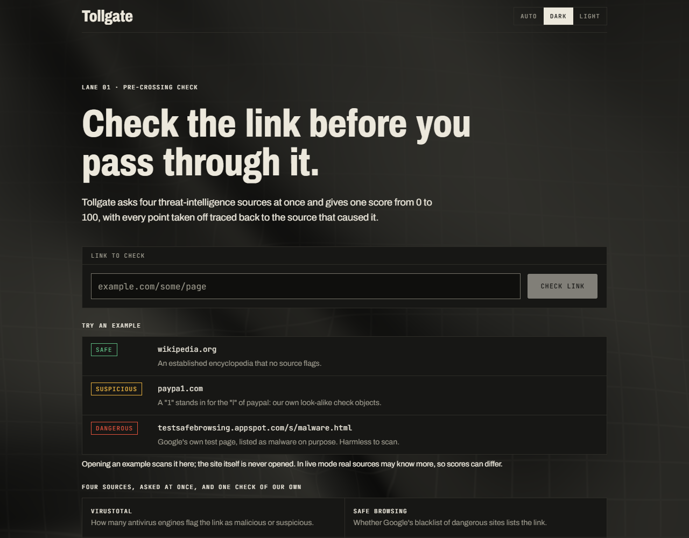
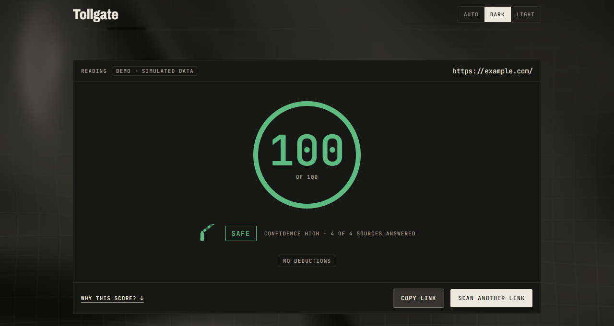
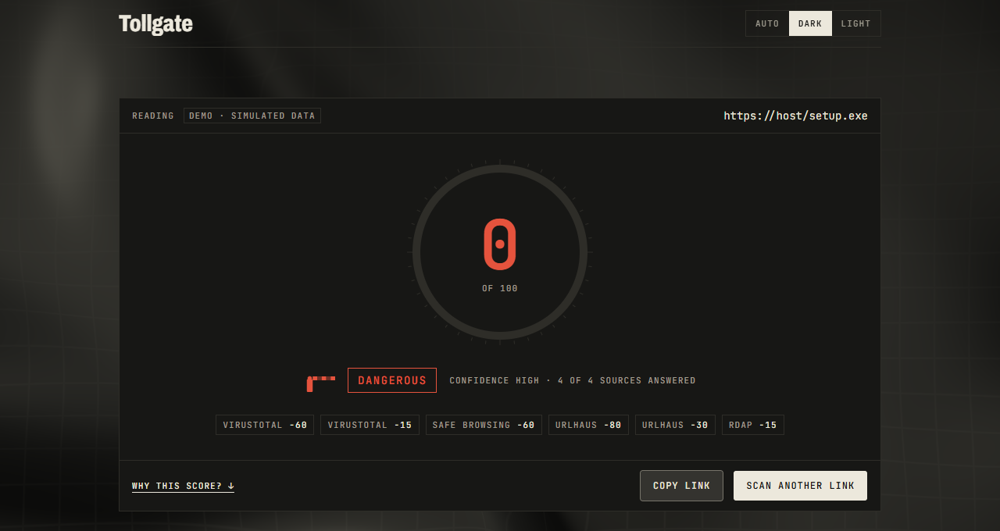
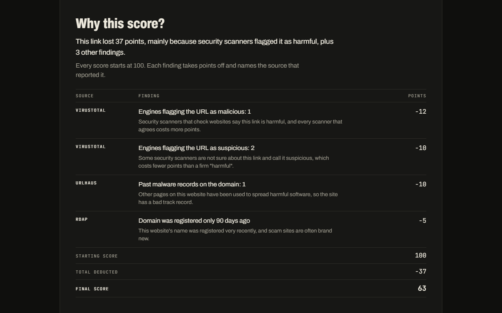
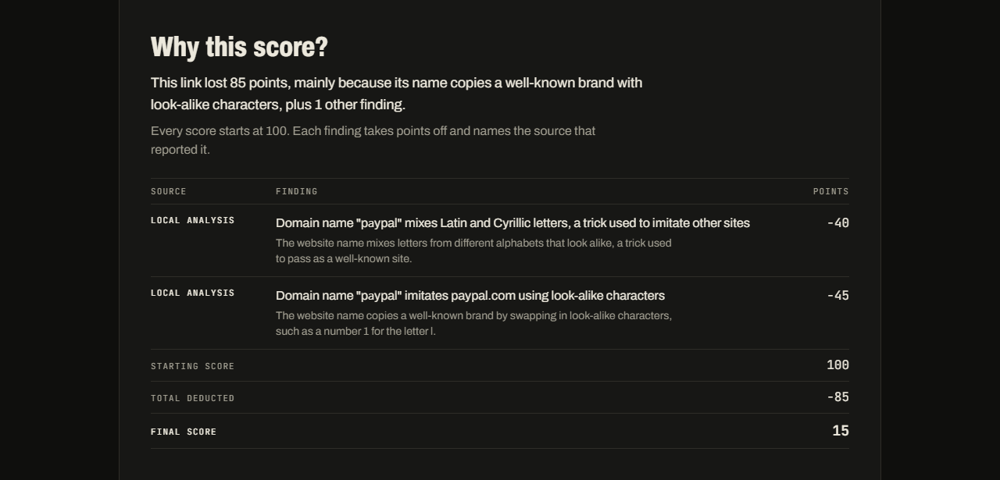
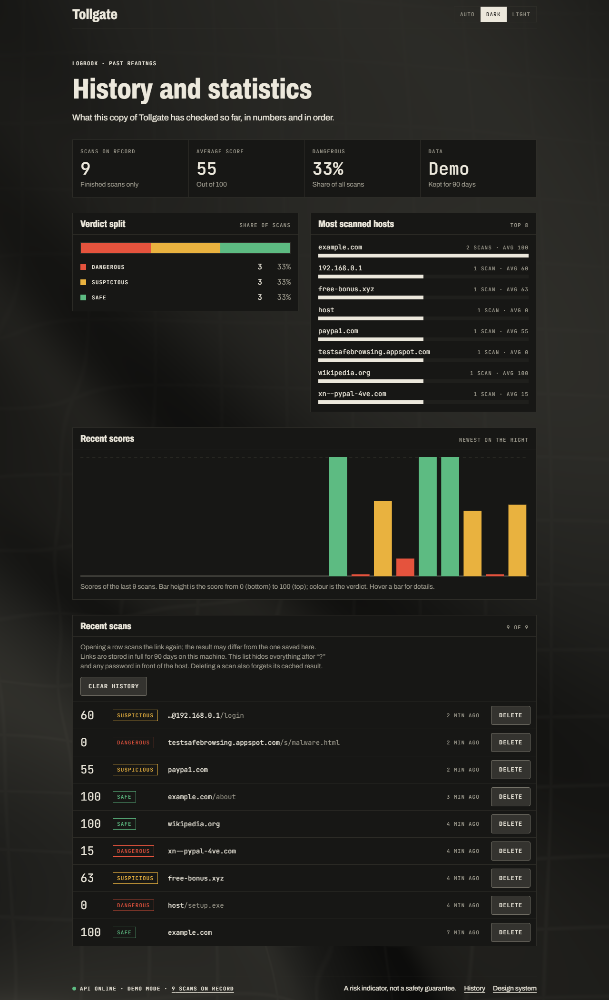
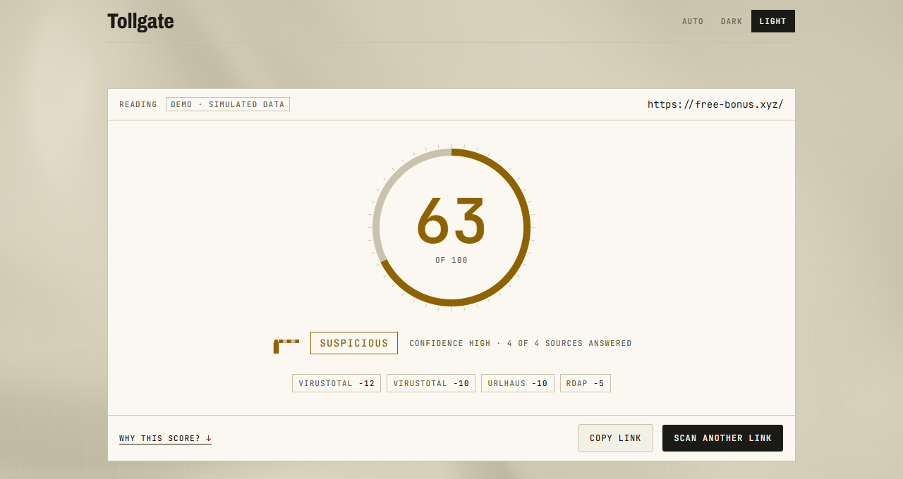
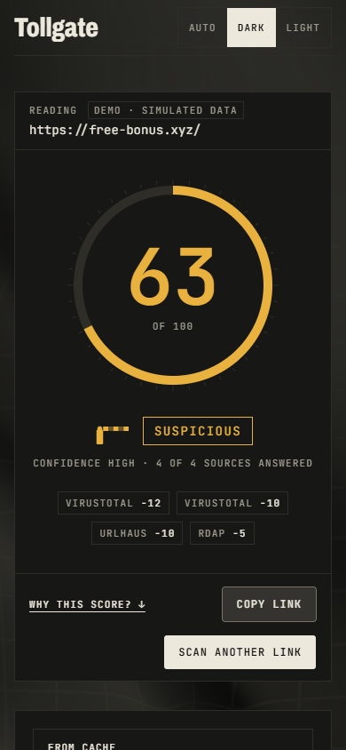
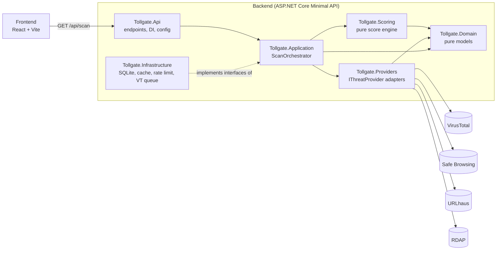

# Tollgate

**Check a link before you pass through it.**

Tollgate takes a URL, asks four threat-intelligence sources about it in parallel, adds a few checks of its own, and returns **one explainable 0-100 trust score**. Every point taken off is traced back to the source that caused it, so the number is never a black box.



> Tollgate is a university project. It is not deployed anywhere and is meant to run on your own machine. The score is a **risk indicator, not a safety guarantee** (see [Limitations](#limitations-and-honesty-notes)).

## Contents

- [Features](#features)
- [Screenshots](#screenshots)
- [How the score works](#how-the-score-works)
- [Example links and their scores](#example-links-and-their-scores)
- [Architecture](#architecture)
- [Tech stack](#tech-stack)
- [Getting started](#getting-started)
- [API](#api)
- [Testing](#testing)
- [Project layout](#project-layout)
- [Limitations and honesty notes](#limitations-and-honesty-notes)

## Features

- **One score, fully explained.** Starts at 100, every finding subtracts points and names its source. A severe finding also sets a *cap*, so clean results from other sources cannot average it away.
- **Four sources in parallel.** VirusTotal, Google Safe Browsing, URLhaus and RDAP (domain age), each with its own timeout, retry and circuit breaker.
- **Local analysis.** Five checks that only look at the shape of the link: look-alike alphabets, brand typos, suspicious endings, raw IP hosts and the `user@host` trick.
- **Honest about missing data.** If a source is down, the scan still completes, that source is shown as *Unavailable* and the confidence level drops. "No source answered" is shown as **No data**, never as Safe.
- **Plain-language explanations.** Each finding has a one-sentence explanation and the page starts with a one-sentence summary.
- **Shareable link.** The address bar holds the scanned link (`/?url=...`), so a result can be re-opened or shared.
- **History and statistics.** Verdict split, most scanned hosts, recent scores and a list of past scans, all kept locally for 90 days.
- **Delete what you scanned.** Remove one scan or clear the whole history with one button (it asks first). The link's cached result is forgotten too, so nothing of it stays in the database.
- **Try an example.** Three example links under the form (Safe, Suspicious, Dangerous) show a full reading before you scan your own link. They only run a scan; the sites themselves are never opened.
- **Demo mode.** With no API keys the whole app runs on simulated sources, which is also a safety net for presentations. Demo and live mode use the **same** scoring code.
- **Designed, not templated.** An "instrument panel" look with dark and light themes, a scroll-driven score reveal and a reduced-motion fallback.

## Screenshots

### Scan a link



### Read the result

A Safe, a Suspicious and a Dangerous reading. Colour is used for the verdict and nothing else.

| Safe | Suspicious | Dangerous |
|---|---|---|
|  |  |  |

### Why this score?

Every deduction, its source, a plain-language sentence and the final arithmetic.



The same table for a link that is judged only by its own shape (look-alike characters in the domain name):



### History and statistics



### Light theme and phones

| Light theme | Phone (390 px) |
|---|---|
|  |  |

> The screenshots were taken in demo mode with simulated data and with motion reduced, so the score is already revealed. In a normal browser the result builds up as you scroll (with a Skip button and the `Esc` key).

## How the score works

```
score = min( 100 - sum(penalties), lowest applicable cap )
```

Caps stop one severe finding from being averaged away by clean results. Every number below lives in `appsettings.json`, none are hard-coded.

| Finding | Source | Penalty | Cap |
|---|---|---|---|
| Each malicious engine | VirusTotal | -12 (max -60) | 2+ engines: 45, 5+ engines: 15 |
| Each suspicious engine | VirusTotal | -5 (max -20) | none |
| Blacklist match | Google Safe Browsing | -60 | 20 |
| URL actively distributing malware | URLhaus | -80 | 5 |
| URL distributed malware in the past | URLhaus | -40 | 35 |
| Past records on the domain | URLhaus | -8 - 2 x records (max -30) | none |
| Domain younger than 30 / 180 days | RDAP | -15 / -5 | none |
| Mixed Latin and Cyrillic or Greek word | Local analysis | -40 | none |
| Brand look-alike characters (`paypa1`) | Local analysis | -45 | none |
| Brand typo (`gooogle`) | Local analysis | -30 | none |
| Raw IP address as host | Local analysis | -15 | none |
| `user@host` trick | Local analysis | -25 | none |
| Suspicious ending (`.top`, `.click`, ...) | Local analysis | -8 | none |
| Non-Latin alphabet | Local analysis | -5 | none |

**Verdicts:** 0-49 **Dangerous**, 50-79 **Suspicious**, 80-100 **Safe**.

**Confidence** says how many of the four main sources actually answered: 4 = High, 2-3 = Medium, 0-1 = Low. Local analysis is not a queried source, so it never changes confidence.

Why local findings never set a cap: they are guesses from the shape of a link, and a guess must not be able to claim certainty.

## Example links and their scores

Ten links to try, from a full score down to zero. The scores below come from **demo mode** (`mode: "Demo"`), where the external sources are simulated and everything else, including scoring, is the real code.

| # | Paste this | Score | Verdict | What happens |
|---|---|:---:|---|---|
| 1 | `example.com` | **100** | Safe | Established, clean domain. No findings. |
| 2 | `outage.example` | **100** | Safe | Safe Browsing and RDAP are simulated as down. The score stands but confidence drops to **Medium**. |
| 3 | `free-prizes.top` | **92** | Safe | Only the suspicious `.top` ending counts against it (-8). |
| 4 | `http://203.0.113.7/login` | **85** | Safe | A raw IP address instead of a name (-15). |
| 5 | `gooogle.com` | **70** | Suspicious | One letter too many: brand typo (-30). |
| 6 | `free-bonus.xyz` | **63** | Suspicious | The "free bonus" example from the original spec: 1 malicious and 2 suspicious engines (-22), a past URLhaus record (-10), domain 90 days old (-5). |
| 7 | `http://google.com@192.168.0.1/login` | **60** | Suspicious | The real host is the IP after the `@` (-25), shown as a raw IP (-15). |
| 8 | `paypa1.com` | **55** | Suspicious | A `1` standing in for the `l` of "paypal" (-45). |
| 9 | `http://xn--pple-43d.com` | **15** | Dangerous | "apple" written with a Cyrillic letter: mixed alphabets (-40) and a brand look-alike (-45). |
| 10 | `downloads.example/setup.exe` | **0** | Dangerous | The `.exe` example from the original spec: malicious engines, on Google's list, actively distributing malware on URLhaus. The penalties add up to more than 100. |

Notes:

- "The original spec" is the project's starting document, a course presentation that is not part of this repository. Its three reference results (a clean domain = 100, the "free bonus" link = 63, the `.exe` download = 0) are locked in by tests.
- Rows 3, 4, 5, 7, 8 and 9 are **local analysis only**, so you get the same deductions in live mode. Live mode may add more, because real sources can know more about a domain.
- Rows 1, 2, 6 and 10 depend on simulated sources. In live mode the same text can score differently: for example `example.com` currently loses 16 points to old URLhaus records (**84**, still Safe). That is real data and a good example of the explanation table.
- Row 4 uses `203.0.113.7`, an address reserved for documentation. Tollgate only studies the *text* of a link and never connects to it.
- The home page's own examples are `wikipedia.org` (100), `paypa1.com` (55) and `testsafebrowsing.appspot.com/s/malware.html` (0 in demo mode). The last one is Google's official Safe Browsing test page: harmless, but listed as malware on purpose, so live mode also reads it as Dangerous.
- The extra demo names `slow-site.com` (VirusTotal answers late, so the page polls) and `malware-test.example` (scores 0) show the pending state and another Dangerous reading.

## Architecture

Tollgate is a **modular monolith**: one deployable, in-process calls, clear module boundaries that could be split later. Microservices would be over-engineering at this scale.



**The scan, step by step**

1. **Validate and normalise** the link: only `http` and `https`, scheme added if missing, `#fragment` dropped.
2. **Cache lookup**: the same link within 60 minutes returns instantly and spends no quota.
3. **Ask the four sources in parallel**, each with its own error handling.
4. **VirusTotal flow**: if VirusTotal has never seen the link, it is submitted for analysis and the page polls until the analysis is complete.
5. **Compute the score** with the pure `Tollgate.Scoring` engine.
6. **Respond** with score, verdict, confidence and every finding with its source.

**Rules that keep it easy to explain**

- `Api -> Application -> Scoring, Providers, Domain`. `Domain` and `Scoring` depend on nothing and contain no I/O.
- `Infrastructure` implements interfaces declared in `Application`. `Api` is the only place that wires concrete classes.
- **Adding a data source = one new `IThreatProvider` class + one DI line.** Nothing else changes.
- **A source failing or timing out never fails the scan.** Its result becomes "unavailable" and lowers confidence.
- The API keys stay on the server. The browser never sees them, and VirusTotal and Safe Browsing block browser calls (CORS) anyway.

## Tech stack

| Layer | Choice |
|---|---|
| Backend | C#, .NET 10, ASP.NET Core Minimal API, OpenAPI |
| Persistence | SQLite via EF Core: evidence cache, scan history (90 days) and statistics, one file per mode |
| Resilience | `Microsoft.Extensions.Http.Resilience` per provider: timeout, retry, circuit breaker |
| Frontend | React, Vite, TypeScript (strict), Tailwind CSS, shadcn/ui |
| API contract | Typed client generated from the backend's OpenAPI (`openapi-typescript` + `openapi-fetch`) |
| Motion | `gsap` + ScrollTrigger for the score reveal |
| Fonts | Archivo and JetBrains Mono, self-hosted |
| Tests | xUnit (backend), Vitest (pure frontend logic) |

## Getting started

**Requirements:** .NET SDK 10 and Node.js (LTS or newer).

### 1. (Optional) Add API keys

Without keys Tollgate runs in **demo mode**, which is enough to try every screen. For live data:

```powershell
Copy-Item .env.example .env      # macOS/Linux: cp .env.example .env
```

Fill in the keys you have. `.env` is git-ignored and keys are never logged or sent to the client.

| Variable | Source | Free tier |
|---|---|---|
| `VT_API_KEY` | VirusTotal v3 | 4 requests/min, 500/day, non-commercial |
| `GSB_API_KEY` | Google Safe Browsing v4 | non-commercial |
| `URLHAUS_AUTH_KEY` | URLhaus (abuse.ch) | non-commercial |
| none | RDAP (`rdap.org`) | needs no key |

<details>
<summary>How to get each key</summary>

**VirusTotal**: sign up at https://www.virustotal.com, confirm your email, open the profile menu, then **API key**. The queue spaces calls 15 s apart and counts the daily total.

**Google Safe Browsing**: in https://console.cloud.google.com create a project, open **APIs & Services > Library**, enable **Safe Browsing API**, then **Credentials > Create credentials > API key** (restricting it to the Safe Browsing API is recommended).
Pitfall: the key must start with `AIza`. A key that starts with `AQ.` (for example the "Default Gemini API Key", or any key created with "Authenticate API calls through a service account" ticked) is rejected with `401 API keys are not supported by this API`. Create a plain API key instead.

**URLhaus**: sign in at https://auth.abuse.ch and copy the **Auth-Key** from your account page. It is sent as an `Auth-Key` header.

**RDAP** needs no key.
</details>

**Live or demo?** Demo mode is used only when *no* key is set. With even one real key the scan is live, and a source without a key is shown as *Unavailable* rather than faked. Every response and the page footer show the mode.

### 2. Start the backend

```powershell
cd backend
dotnet run --project src/Tollgate.Api
```

It listens on http://localhost:5297. Swagger UI is at `/swagger` and the OpenAPI document at `/openapi/v1.json`. The SQLite files are created on first start in `backend/src/Tollgate.Api/data/` (delete them to reset history and cache).

### 3. Start the frontend

In a second terminal:

```powershell
cd frontend
npm install
npm run dev
```

Open http://localhost:5173/tollgate/ (the app is served under `/tollgate/`, the same path as on GitHub Pages). In development Vite forwards `/api` calls to the backend, so there is no CORS policy to configure.

| Route | What it is |
|---|---|
| `/` | The scan form. `/?url=<link>` scans a link straight away |
| `/history` | History and statistics dashboard |
| `/design` | The live design system (colour tokens, type, components) |

### Limits worth knowing

- 20 requests per minute per client. Beyond that the UI shows a "request limit reached" message.
- VirusTotal calls are spaced 15 seconds apart and counted against the 500/day quota, so a first scan of a never-seen link can take about 20 seconds.
- The same link within 60 minutes is served from the cache.

## API

The contract is published as OpenAPI and the frontend client is generated from it.

| Endpoint | Returns |
|---|---|
| `GET /api/scan?url=<url>` | Score, verdict, confidence, findings and per-source state. While VirusTotal is still analysing, `status` is `Partial` (provisional score): ask again after a few seconds, the finished reading has `status: "Complete"` |
| `GET /api/history?limit=<n>` | The newest finished scans |
| `GET /api/stats` | Totals, average score, verdict split, dangerous ratio and most scanned hosts |
| `DELETE /api/history/{id}` | Deletes one scan (`id` comes from `/api/history`) and forgets that link's cached result. `204`, or `404` if there is no such scan |
| `DELETE /api/history` | Deletes every scan and empties the cache. `204` |

Example (`GET /api/scan?url=free-bonus.xyz` in demo mode):

```json
{
  "status": "Complete",
  "mode": "Demo",
  "url": "https://free-bonus.xyz/",
  "score": 63,
  "verdict": "Suspicious",
  "confidence": "High",
  "findings": [
    { "source": "VirusTotal", "kind": "EnginesMalicious", "description": "Engines flagging the URL as malicious: 1", "pointsDeducted": 12 },
    { "source": "VirusTotal", "kind": "EnginesSuspicious", "description": "Engines flagging the URL as suspicious: 2", "pointsDeducted": 10 },
    { "source": "UrlHaus", "kind": "DomainHasMalwareRecords", "description": "Past malware records on the domain: 1", "pointsDeducted": 10 },
    { "source": "Rdap", "kind": "DomainRecentlyRegistered", "description": "Domain was registered only 90 days ago", "pointsDeducted": 5 }
  ],
  "sources": [
    { "source": "VirusTotal", "state": "Completed" },
    { "source": "SafeBrowsing", "state": "Completed" },
    { "source": "UrlHaus", "state": "Completed" },
    { "source": "Rdap", "state": "Completed" }
  ],
  "fromCache": false,
  "scannedAt": "2026-11-11T15:14:17+00:00"
}
```

Each finding carries a stable `kind` code. Clients, including this frontend, key their explanations on `kind` and never on the wording of `description`. A finding that sets a cap also has a `scoreCap`.

## Testing

```powershell
# Backend (from backend/): 363 tests
dotnet test

# Frontend (from frontend/)
npm test          # 109 tests of the pure logic
npm run build     # type-check + production bundle
npm run lint
```

| Project | Tests | What it covers |
|---|---:|---|
| Domain | 28 | URL normalisation and validation |
| Scoring | 143 | The score engine and local heuristics, read from the real `appsettings.json` |
| Providers | 65 | Each adapter against a fake HTTP handler |
| Application | 16 | The orchestrator with scripted providers: parallelism, cache, failure isolation |
| Infrastructure | 38 | SQLite cache and history on a real temp file (including deletion), VirusTotal queue |
| Api | 73 | The whole app started in memory, no keys and no internet needed |

Frontend tests cover logic only (scan polling state machine, failure mapping, result reading, plain-language wording, share link, chart geometry and so on). Components are checked visually at 390 px and 1280 px.

After any change to a response type, regenerate the client with `npm run api:types` while the backend runs.

## Project layout

```
backend/
  Directory.Build.props       shared target framework, language settings and test packages
  src/
    Tollgate.Domain/          pure models (ScanResult, Finding, Verdict)
    Tollgate.Scoring/         pure score engine + local URL heuristics
    Tollgate.Providers/       IThreatProvider + VirusTotal / SafeBrowsing / UrlHaus / Rdap / Demo
    Tollgate.Application/     ScanOrchestrator, abstractions, options
    Tollgate.Infrastructure/  EF Core + SQLite, cache, rate limiter, VirusTotal queue
    Tollgate.Api/             Minimal API endpoints, DI wiring, configuration
  tests/                      one test project per module
frontend/
  src/
    app/                      shell, router, theme, page titles
    features/                 scan, result, history, design (components / hooks / logic / api)
    components/               shadcn/ui and brand components
    lib/api/                  generated schema and typed client
docs/screenshots/             images used in this README
```

## Limitations and honesty notes

- **A risk indicator, not a guarantee.** A brand-new phishing page that is on no list yet can look safe. Treat the score as one input to your own judgement.
- **No data is not safe.** If no source answered, Tollgate says so instead of showing a good score.
- **RDAP does not return a registration date for every country-code domain.** The domain-age check is then skipped for that scan.
- **Non-commercial data.** The VirusTotal public API, Google Safe Browsing v4 and URLhaus are free for non-commercial use only. Commercial equivalents exist (for example the Web Risk API for Google).
- **Not deployed.** There are no accounts, no hosting and no production hardening. History keeps full links for 90 days on your machine, and the history screen hides query strings and credentials.
- **A shared link re-runs the scan.** Results are not stored under an id: the shared address scans again, and the 60-minute cache normally gives the same reading.
